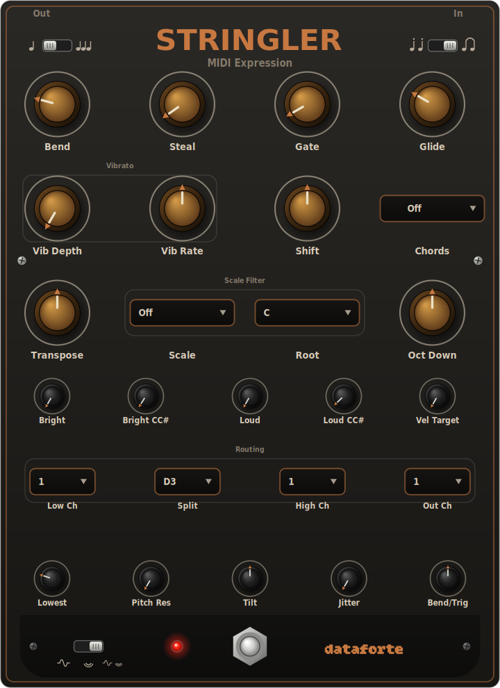

# Stringler

<p align="center">
  
</p>

An expressive **guitar-MIDI engine**: it takes MIDI in and turns it into the
guitar-style MIDI a guitarist would expect — legato glides with bending,
automatic vibrato, note stealing, chord shifting and a chord wheel, scale
filtering, velocity-driven brightness/loudness CCs, an octave-down
companion and lows/highs channel splitting — as an LV2 (with a modgui),
VST3 and CLAP plugin and a standalone JACK app, with a scalable GUI.

Stringler is a functional recreation of the core of a commercial
guitar-MIDI plugin (the product name is deliberately omitted), built with
[DPF](https://github.com/DISTRHO/DPF) after reverse engineering its shipped
Windows VST3 with REA (a reverse-engineering MCP tool driving Ghidra).
Plug a guitar into the audio input and it tracks it (monophonic, classical
DSP — see [The tracker](#the-tracker)); it also accepts MIDI directly, and
either source can feed the expression engine. The original's neural
tracker, amp models, sampler banks, hex-pickup support and backing-track
engine are out of scope (see [Research](#research)).

## The tracker

The audio input is tracked by a monophonic detector (FFT-accelerated YIN):
an analysis window sized from the lowest accepted note (~70 Hz), a
256-sample hop, cumulative-mean-normalized difference with parabolic
refinement, then two-hop stability before a note is committed. Velocity is
derived from the RMS level, and **Gate is therefore the input-level
threshold**: level maps linearly from −60 dB (velocity 0) to 0 dB
(velocity 127), so a gate of 0.1 ignores anything below about −54 dB.
Notes are emitted on channel 0 and go through the same engine, so legato,
stealing, scale filtering, split and the rest apply unchanged.

- **MONO** (MODE = 0): the YIN detector; latency is roughly the window
  plus one hop, ~40 ms at 48 kHz with the default E2 setting (it grows with
  lower notes and higher pitch resolution, exactly as the original's
  "lower notes => more latency" / "higher resolution => more latency").
- **POLY** (MODE = 1): a harmonic-comb detector over an ~85 ms window and a
  finer grid. Spectral peaks are matched in cents over harmonics 1..8 (odd
  harmonics weighted higher), up to four notes are taken per analysis, and
  each winner's harmonics are cancelled before the next pick to suppress
  octave errors. Analyses run on every fourth hop, so latency is ~100 ms.
  It is **experimental**: dense or distorted material can produce spurious
  or missing notes, and octave doublings may be merged into the lower note.
- **Bends** (MONO, BEND > 0): pitch movement inside the bend window is sent
  as a pitch bend, so string bends and vibrato come through without
  retriggering; larger movements commit a new note. The window is set by
  **BEND/TRIG** — the original's "note bend vs triggers" tweak: 0 % = always
  retrigger, 50 % = ±1.5 semitones, 100 % = ±2.8 semitones (capped by the
  BEND range). Poly tracks note-level only.

The tracker section on the face carries the settings recovered from the
original's tracker page:

| Control | Meaning |
|---|---|
| **Lowest** | lowest note the tracker accepts (A1…C4, default E2); lower notes need a longer window, so they cost latency |
| **Pitch Res** | analysis length in periods (3…4.5); higher = steadier low notes, more latency |
| **Tilt** | harmonic tilt for the poly comb (0…4, 2 = neutral); compensates bright/dark instruments and reduces octave errors |
| **Jitter** | number of agreeing analyses before a note commits (0 = fastest, 3 = most stable) |
| **Bend/Trig** | pitch-movement policy in MONO: 0 = retrigger notes, 100 = bend the sounding note (default 50 = ±1.5 semitones) |

## The engine

```
audio in ──► tracker (mono) ─┐
                             ├─► gate ──► pitch transforms ──► scale filter
MIDI in ────────────────────┘              (shift + transpose)      │
                                                                    ▼
        voice allocation ──► legato glide / stealing / mono takeover  ──► velocity norm
              │
              ├──► chord wheel (major / minor / diminished)
              ├──► octave-down companion
              ├──► brightness + loudness CCs (from velocity)
              └──► out channel, or lows/highs split
                                   │
                                   ▼
                                MIDI out
```

- **Gate** — notes whose velocity is below the gate (0–1 × 127) are dropped,
  as the original's "notes will trigger when the indicator is above the
  gate".
- **Pitch transforms** — CHORD SHIFT (−12…+12) and TRANSPOSE (−24…+24)
  add up. The **scale filter** then keeps only pitches of the selected
  scale (17 scales from the original's help machine: major, minor,
  harmonic/melodic minor, the modes, spanish, flamenco, blues, chromatic)
  around the ROOT. Notes outside the scale are silently dropped.
- **Voice allocation** — MONO (a new note takes over the sounding voice) or
  POLY (new notes get their own voice; a note within STEAL semitones on the
  same input channel steals the nearest voice). The pool holds 24 voices;
  exhausting it steals the oldest. STEAL 0 disables stealing ("No note
  stealing"), matching the original's "Steal notes within N semitones".
- **Legato** — with LEGATO on and BEND > 0, a new note within the bend range
  of a sounding voice does not retrigger: the engine sends the new note at
  the old pitch, ramps a pitch bend over GLIDE ms, and at the landing swaps
  the old note off for the new note on (deferred, so the downstream
  instrument never hears an intermediate pitch step).
- **Auto vibrato** — a sine pitch bend at VIB RATE Hz and VIB DEPTH cents,
  starting at a random phase per note.
- **Chord wheel** — with CHORD WHEEL on, every fresh note adds two chord
  tones, cycling major → minor → diminished; tones outside the active
  scale are omitted. The companion velocities are estimates (the original's
  weighting is not recoverable from the binary).
- **Octave-down** — a second note one octave below at OCT DOWN × velocity
  (0 = off). The original plays it at half velocity; here the multiplier is
  exposed, and the presets use 0, 0.5 and 1.0.
- **Brightness / loudness CCs** — on every note-on the engine sends the
  configured CCs with `min(1, velocity × amount) × 127`. (The original
  derives them from the measured picking dynamics of each audio frame;
  velocity is the proxy available at MIDI level — a documented estimate.)
- **Split** — notes below SPLIT go to LOWS CH, the others to HIGHS CH;
  SPLIT 0 routes everything to OUT CH.
- **Bypass** — the designated bypass parameter; the MIDI passes through
  untouched while bypassed.

The audio ports are a transparent stereo passthrough (a plain buffer
copy), so the plugin also loads in hosts and pedalboards that expect an
effect; all of Stringler's processing is MIDI.

## Controls

All parameters are LV2 control ports (port 6 + parameter index). The
bypass parameter is exported as the `lv2:enabled` port (35), so hosts that
understand it show their own bypass control. Parameters with named values
(tracking mode, legato, source, chord wheel, scales, root) are declared as
LV2/CLAP/VST3 **enumerations**, so hosts present them as dropdowns with the
names instead of raw numbers.

| # | Symbol        | Range      | Default | Meaning |
|---|---------------|------------|---------|---------|
| 0 | `mode`        | 0–1        | 0       | 0 = mono tracking, 1 = polyphonic |
| 1 | `bend`        | 0–48 st    | 12      | master bend range; 0 disables bends (and glides) |
| 2 | `steal`       | 0–12 st    | 1       | steal notes within N semitones; 0 = none |
| 3 | `gate`        | 0–1        | 0.1     | velocity gate |
| 4 | `legato`      | 0–1        | 1       | legato transitions on/off |
| 5 | `legatoms`    | 0–100 ms   | 30      | legato glide time |
| 6 | `vibdepth`    | 0–200 ct   | 0       | automatic vibrato depth |
| 7 | `vibrate`     | 0–10 Hz    | 5       | automatic vibrato rate |
| 8 | `chordshift`  | −12…+12 st | 0       | chromatic chord shift |
| 9 | `chordwheel`  | 0–3        | 0       | 0 off, 1 major, 2 minor, 3 diminished |
| 10| `transpose`   | −24…+24 st | 0       | transpose |
| 11| `scale`       | 0–17       | 0       | 0 off, 1…17 scale filter |
| 12| `root`        | 0–11       | 0       | scale root (C…B) |
| 13| `octdown`     | 0–2        | 1       | octave-down velocity multiplier; 0 = off |
| 14| `split`       | 0–64       | 50      | lows/highs split pitch; 0 = off |
| 15| `lowschan`    | 1–16       | 1       | MIDI channel for notes below the split |
| 16| `highschan`   | 1–16       | 1       | MIDI channel for notes at/above the split |
| 17| `brightamt`   | 0–2        | 0       | brightness CC amount |
| 18| `brightcc`    | 0–127      | 1       | brightness CC number |
| 19| `loudamt`     | 0–2        | 0       | loudness CC amount |
| 20| `loudcc`      | 0–127      | 7       | loudness CC number |
| 21| `velnorm`     | 0–127      | 0       | velocity normalize target; 0 = off |
| 22| `outchan`     | 1–16       | 1       | output MIDI channel (when no split) |
| 23| `source`      | 0–2        | 2       | 0 = audio tracker, 1 = MIDI input, 2 = both |
| 24| `tracklow`    | 33–60      | 40      | lowest tracked note (E2) |
| 25| `trackres`    | 0–3        | 0       | pitch resolution: analysis length 3–4.5 periods |
| 26| `trackbright` | 0–4        | 2       | poly harmonic tilt (2 = neutral) |
| 27| `trackjitter` | 0–3        | 0       | agreeing analyses required before a note commits |
| 28| `bendtrig`    | 0–100 %    | 50      | bend vs trigger balance (bend window 0.2–2.8 semitones) |
| 29| `bypass`      | 0–1        | 0       | bypass (exported as `lv2:enabled`) |

The original exposes four tracking modes — "Expressive tracking, polyphonic
expression (default)", "Polyphonic tracking with no bends", "Monophonic
tracking (fastest)" and "Fastest tracking, polyphonic expression, but with
less polyphony" — which differ in latency, polyphony and bend support inside
the audio tracker. At MIDI level only the mono/poly distinction changes the
output, so Stringler models that (with bends switchable via BEND = 0).

## Presets

The original's factory presets are stored in protected blobs and could not
be recovered, and Stringler's presets are likewise **house designs**: they
exercise the engine's ranges rather than reproducing any specific patch.
They are data, not code.

| Preset | Character |
|---|---|
| Open Strings | balanced starting point: poly-capable mono tracking, legato 30 ms, split at E3 |
| Singing Line | wider bend, longer glide, gentle vibrato, loudness CC |
| Chord Cycle | poly, chord wheel cycling major/minor/diminished, brightness CC |
| Midnight Shades | minor scale filter, deep vibrato, octave-down companion |
| Tight Rhythm | poly, no legato, higher gate, velocity normalization |
| Long Glide | very wide bend, slow glide, deep slow vibrato |

`presets/stringler.json` is the source of truth; `make presets` regenerates
`plugins/Stringler/Presets.hpp`, which DPF exposes as programs (LV2
`presets.ttl`, VST3/CLAP programs).

## GUI

Both GUIs draw the same pedal: a dark graphite faceplate with a copper
wordmark, three rows of brass knobs (tracking / expression / harmony), two
rows of small black knobs for dynamics and routing, two slide switches
(MODE, LEGATO), a TRACKER row (LOWEST, PITCH RES, TILT, JITTER,
Bend/Trig), a Source switch, a footswitch and an LED. The switches are
symbolic: Mode is flanked by a single note (mono) and a three-note chord
(poly); Legato by two detached notes and two slurred ones; Source by a
waveform (audio), a five-pin DIN connector (MIDI) and both together.
Related controls are boxed together (VIBRATO, SCALE FILTER, ROUTING). The parameters with
named values that used to be knobs — CHORD WHEEL, SCALE and ROOT — are
selector badges: click the arrows (or use the wheel) to step through Off,
Major, Minor, Diminished, the seventeen scales/notes, the MIDI channels
(Low Ch, High Ch, Out Ch) and the split note (E2…E4, between the two
channel selectors). Long lists can also be dragged. The chord wheel badge
draws a small chord symbol (the dot spacing follows the major/minor/
diminished intervals) beside the name. Names and branding are our own.

- **Desktop** (LV2, VST3, CLAP, standalone): vector cairo drawing, so it
  scales cleanly. The aspect ratio is kept and the host's HiDPI factor is
  honoured. Drag knobs up/down (Shift for fine), use the wheel,
  double-click to reset, click switches and the footswitch. Hover a control
  for half a second to see its name and current value in a tooltip.
- **modgui**: `modgui/` is rendered from the same artwork
  (`make modgui`), with film-strip knobs and switches at 2× resolution.

House rule: pedal-face UIs use cairo (CPU raster, no OpenGL), so the
desktop UI, the modgui and the screenshots come from one drawing routine.

## Building

Built with DPF (a git submodule; it vendors pugl for the window). One
codebase gives an LV2 bundle (DSP and UI in separate binaries, plus the
modgui), a VST3, a CLAP and a standalone JACK app. It needs a C++ compiler;
the UI also needs the cairo and X11 development headers and is skipped
automatically if they are missing.

```
git submodule update --init --recursive
make                # all formats into bin/
make NOUI=true      # DSP only (build hosts without cairo/X11)
make install        # LV2 bundle into /usr/lib/lv2 (INSTALL_DIR=...)
make install-all    # + VST3, CLAP and the JACK app (VST3_DIR, CLAP_DIR, BIN_DIR)
make test-all       # MIDI engine, CLAP, UI (Xvfb) and modgui (headless Chrome) tests
make modgui         # re-render modgui/ from the artwork
make screenshot     # re-render screenshot.png from the artwork
```

There is no audio DSP to generate: the audio path is a stereo passthrough
(a buffer copy in `run()`), and all instrument logic lives in the MIDI
engine — the DPF plugin class (`plugins/Stringler/PluginStringler.cpp`).
Raw `MidiEvent` arrays arrive in `run()`, are decoded, processed and
written back with `writeMidiEvent()` (deferred flushes are emitted at the
top of the next block, since writes are only legal inside `run()`).

The LV2 plugin uses the atom/events ports for MIDI (this DPF revision
routes MIDI through `lv2:AtomPort` sequences of `lv2:MidiEvent`, not the
legacy MIDI ports): ports 0–3 are the stereo audio in/out, 4/5 the event
in/out and 6…29 the 24 control ports.

## Tests

- `tests/sl_test.c` — loads the LV2 DSP through the raw C API and drives
  the engine through LV2 atom events: passthrough, octave-down companion,
  gate, transpose, scale filter, velocity normalization, bypass,
  polyphonic stealing, legato glide timing (deferred landing and pitch
  bend ramp), a 4096-block fuzz run and three other sample rates. It also
  feeds synthetic audio to the tracker (notes E2–E4, velocity from level,
  release on silence, gate, source routing).
- `tests/clap_check.c` — factory/activate/process smoke test and parameter
  inventory (24 parameters, GUI extension).
- `tests/ui_test.c` — embeds the real X11 UI in a test host under Xvfb and
  drives it with XTest: host→UI values, knob drag, wheel, double-click
  reset, switch and footswitch clicks, resizes, screenshots.
- `tests/modgui_check.py` — renders the generated modgui in headless Chrome
  at known values and compares every control region with the cairo render.

## Research

The shipped plugin is a hand-packed Windows blob (a PE DLL plus a
scrambled ZIP), not a spec-valid VST3 container; the same pattern appears
in other third-party instrument plugins. The analysis used REA with a
Ghidra provider on the extracted DLL:

- The C++ core is stripped, so the analysis is string-xref driven. The
  expression logic lives in restored Lua machines (`Helpers/Scales.lua`,
  `Helpers/Chords.lua`, the settings/help machines) — the scale and chord
  tables and parameter descriptions in Stringler are taken from them
  verbatim.
- Parameter semantics are confirmed by the binary's own UI strings:
  "Steal notes within N semitones" for N = 2…12 plus "No note stealing"
  (range 0–12), the four tracking-mode descriptions quoted above, "Set the
  lowest note of your guitar tuning", and the octave-down note ("Also play
  a note an octave lower with half the velocity").
- The neural tracker, amp models (Deep*), sampler banks, hex-pickup
  handling, the backing-track engine, the autopitch/autobass engines and
  the cloud/licensing layer are separate subsystems of the original and
  are not recreated.
- The original's factory presets are stored in protected blobs, so its
  preset values are unrecoverable; Stringler's six presets are house
  designs, not transcriptions.

The recreated pipeline follows the original's documented behaviour. Where
the binary does not pin a value down — chord companion velocities, the
velocity→CC law, the exact glide timing curve — the code says so in
comments, and the README notes it.

**[docs/INTERNALS.md](docs/INTERNALS.md)** walks through the whole engine:
the mono and poly trackers stage by stage, note filtering, voice
allocation, the expression stages (glide, vibrato, tracker bends, chord
wheel, octave down, dynamics CCs), channel routing, a full control
reference and worked examples.

**[docs/TRACKER-COMPARISON.md](docs/TRACKER-COMPARISON.md)** compares the
tracker with GuitarMidi-LV2's filterbank-plus-neural-net detector, stage by
stage, with the pros and cons of each approach.

## Layout

```
plugins/Stringler/                  DPF plugin: info, MIDI engine, UI, artwork
  PluginStringler.cpp               the MIDI engine (decode → process → encode)
  UIStringler.cpp                   cairo UI (mouse/wheel/keyboard-free)
  Artwork.hpp                       the pedal, drawn with cairo (shared by both GUIs)
  Presets.hpp, BrandPath.hpp        generated from presets/stringler.json and the font
tools/render_modgui.cpp             renders modgui/ (images, HTML, CSS) from the artwork
tools/gen_presets.py                presets/stringler.json → Presets.hpp
tools/gen_brand.py                  Bitcount wordmark → BrandPath.hpp
modgui/                             generated modgui (checked in)
tests/                              the four test suites (see above)
docs/INTERNALS.md                   how the engine works, stage by stage
docs/TRACKER-COMPARISON.md          Stringler's tracker vs GuitarMidi-LV2's
dpf/                                DPF submodule
```

## License

GPL-2.0-or-later (see LICENSE).
